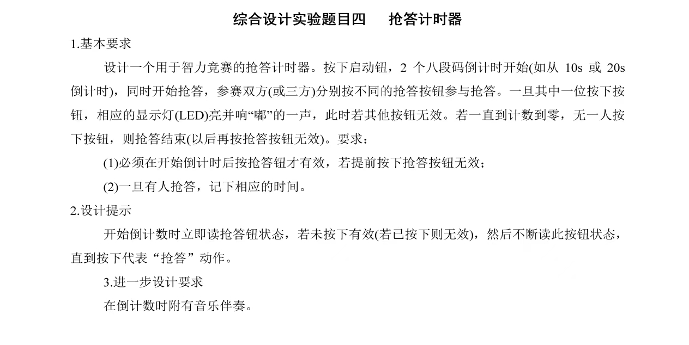

# 8086 微机原理课程设计

两个基于 8086 + 典型外围芯片的汇编实验，配套 Proteus 仿真工程：

1. **抢答计时器** —— 8255 + 8254，20 秒倒计时、双人抢答、动态扫描数码管、蜂鸣器提示
2. **ADC0808 定时采样显示** —— 8253 两级分频产生 10 Hz 中断，8259 响应后在中断服务程序中采样并在数码管上显示高 4 位

代码为 8086 实模式汇编，MASM/TASM 语法，已在 Proteus 中验证。


---

## 目录结构

```
8086-microcomputer-lab/
├── 01-buzzer-timer/
│   ├── buzzer_timer.asm          # 抢答计时器完整实现（343 行）
│   └── README.md
├── 02-adc0808-sampling/
│   ├── adc0808_original.asm      # 初版：过程式内联写法（217 行）
│   ├── adc0808_refactored.asm    # 重构版：子程序化 + 常量端口（318 行）
│   ├── proteus/
│   │   └── adc0808_demo.pdsprj   # Proteus 仿真工程
│   └── README.md
├── docs/
│   └── assignment.jpg            # 抢答计时器实验要求
├── LICENSE
└── README.md
```

---

## 实验一：抢答计时器

### 要求

设计一个智力竞赛用的抢答计时器：按下启动键后两位数码管开始倒计时（20 秒），同时选手可以抢答；任一方按下抢答键，对应 LED 点亮并响一声，此后其他按键全部失效；若倒计时归零仍无人抢答，抢答结束。

两个易错点，实验要求里明确写了：

- **倒计时开始前的抢答无效**
- **一旦有人抢答成功，需记录抢答方**



### 硬件连接

| 芯片 | 端口地址 | 用途 |
|---|---|---|
| 8255 PA | `298H` | 数码管段码输出 |
| 8255 PB | `299H` | PB0/PB1 位选，PB7 驱动蜂鸣器 |
| 8255 PC | `29AH` | PC0 启动键，PC1/PC2 抢答键（低电平有效） |
| 8255 控制口 | `29BH` | 方式 0，`81H`（PA/PB 输出、PC 低 4 位输入） |
| 8254 通道 0 | `280H` | 定时基准 |
| 8254 控制口 | `283H` | 通道 0 方式 0 |

> 实验箱上的定时器为 8254（8253 的改进型，编程方式兼容）。若使用 8253，代码无需改动。

### 状态机

三个标志位构成系统的全部状态：

```
RUN_FLAG    0 = 未启动     1 = 倒计时中
LOCK_FLAG   0 = 可抢答     1 = 已锁定（有人抢答 或 时间耗尽）
WINNER      0 = 无人       1 = 1 号抢答     2 = 2 号抢答
```

`CHECK_ANSWER_KEY` 进入时先做双重判定——`RUN_FLAG` 必须为 1、`LOCK_FLAG` 必须为 0，否则直接返回。这两行就是"倒计时开始前抢答无效"和"抢答后其他按钮失效"的实现。

### 几个实现细节

**按键消抖**：每个按键检测都走"读 → 延时 → 再读"的两段式，两次电平一致才认账。启动键和抢答键共用 `KEY_DELAY`。

**拆位显示**：`CUR_TIME` 拆十位个位借了一条 8086 指令的巧劲 ——

```asm
MOV AL, CUR_TIME
AAM                 ; 非压缩 BCD 调整：AH = 十位，AL = 个位
MOV SHOW_TEN, AH
MOV SHOW_ONE, AL
```

`AAM` 本意是乘法后做 BCD 调整，但在不压缩十进制场景下，它等价于"除以 10，商进 AH、余数留 AL"，比 `DIV` 省一个操作数、也快一些。

**动态扫描**：两个数码管共用一个段码口，靠 PB0/PB1 位选轮流点亮。每一轮先灭段码、再切位选、最后送段码，避免切换瞬间的"鬼影"。位选操作刻意用 `AND AL,0FCH` 只清最低两位、保留 PB7 的蜂鸣器电平，这样扫描不会把蜂鸣器带灭。

**超时处理**：`CUR_TIME` 减到 0 时置 `LOCK_FLAG=1`、`RUN_FLAG=0` 跳进 `HOLD_RESULT` 死循环持续刷新显示，结果定格在屏上。

---

## 实验二：ADC0808 定时采样显示

### 信号链

```
1 MHz 时钟
   │
   ├─ 8253 计数器 0：方式 3，初值 03E8H(1000) ── 1 MHz / 1000 = 1 kHz 方波
   │
   └─ 8253 计数器 1：方式 2，初值 0064H(100) ── 1 kHz / 100 = 10 Hz
                                                    │
                                             8259 IR0（中断类型 60H）
                                                    │
                                            中断服务程序
                                                    │
                                   启动 ADC0808 → 延时 → 读结果
                                                    │
                                   取高 4 位 → 查表 → 8255 PB → 数码管
```

两级分频的理由：8253 单级计数器最大计数值 65536，1 MHz 下最慢只能到约 15 Hz，凑不出干净的 10 Hz。拆成 1000 × 100 两级即得到精确的 1 kHz → 10 Hz。

### 端口分配

| 芯片 | 端口 | 说明 |
|---|---|---|
| 8253 计数器 0 / 1 | `200H` / `202H` | 控制口 `206H` |
| 8259 命令 / 数据口 | `300H` / `302H` | ICW1/2/4 = `13H`/`60H`/`01H` |
| 8255 PB / 控制口 | `102H` / `106H` | 方式 0 全输出（`80H`） |
| ADC0808 | `400H` | 写入启动转换，读取得结果 |

### 初版与重构版

同一功能的两个版本，`adc0808_original.asm` 是最初交上去的样子，`adc0808_refactored.asm` 是后来重写的。

- **结构** —— 初版把初始化与中断逻辑全部内联在 `START` 和 `INT_PROC` 里；重构版拆成 `SETUP_INTERRUPT` / `INIT_PARALLEL_PORT` / `INIT_TIMER_MODULE` / `INIT_INTERRUPT_CTRL` 四个初始化子程序。
- **中断服务** —— 初版是一整个长过程；重构版 `IRQ_HANDLER` 只做流程编排，实活分派给 `TRIGGER_ADC` / `WAIT_ADC_DONE` / `PROCESS_ADC_DATA` / `SEND_EOI_TO_PIC`。
- **端口地址** —— 初版散落在各处的立即数；重构版全部提为 `EQU` 常量，改板子只改一处。
- **取高 4 位** —— 初版 `SHR AL,1` 连写四次；重构版 `MOV CL,04H` + `SHR AL,CL`。
- **注释** —— 初版按段分节；重构版每个子程序带功能说明与寄存器约定。

重构的方向很明确：**让中断服务程序退化成一张流程图**。原来读 `INT_PROC` 要从头顺到尾才知道在干什么，重构后 `IRQ_HANDLER` 本身就能读出"启动转换 → 等转换完 → 处理数据 → 发 EOI"这条主线，细节下沉到子程序。

---

## 如何运行

### 汇编

MASM 5.x / 6.x 或 TASM：

```bat
masm buzzer_timer.asm;
link buzzer_timer.obj;
```

> 源文件为 UTF-8 编码。老版本 MASM 对 UTF-8 中文注释支持不佳，若汇编报错，用支持 UTF-8 的编辑器（VS Code / Notepad++）另存为 GBK 后再汇编。

### 仿真

`02-adc0808-sampling/proteus/adc0808_demo.pdsprj` 用 Proteus 8 打开即可。工程内已搭好 8253、8259、8255、ADC0808 与数码管，需要把汇编生成的 `.exe` 载入 8086 元件的程序存储器。

抢答计时器未随附仿真工程，需按上文端口表自行连线。

---

## 已知限制

写在这里是因为它们是真实存在的、而不是"理论上可能有"的问题：

1. **ADC 转换完成靠盲延时，没有查 EOC。** `WAIT_ADC_DONE` 用 `LOOP` 空转固定次数来等转换结束。ADC0808 的转换时间随时钟频率变化（典型 100 µs），固定延迟在时钟变慢时会读到无效数据。规范做法是把 EOC 引脚接到 8255 的某一位上轮询，或改用中断。
2. **抢答器的 10 ms 基准是软件延时。** `WAIT_10MS` 的注释写的是读 8254 当前计数值，实际实现是"扫描显示 4 次"的循环延时，倒计时精度依赖循环开销，会随主频漂移。`MOV CX,4` 这个魔数也是试出来的。
3. **ADC0808 的 START 与 OE 共用同一端口地址。** 仿真中通过读写方向区分，真实电路上这两个是独立控制信号，直接照搬到硬件会出问题。
4. **中断服务程序内层子程序重复保存了现场。** `IRQ_HANDLER` 已 `PUSH` 全部寄存器，各子程序内部又各自 `PUSH`/`POP` 一遍，属于冗余保护，不影响正确性但增加了中断延迟。

---

## 许可证

[MIT](LICENSE)
